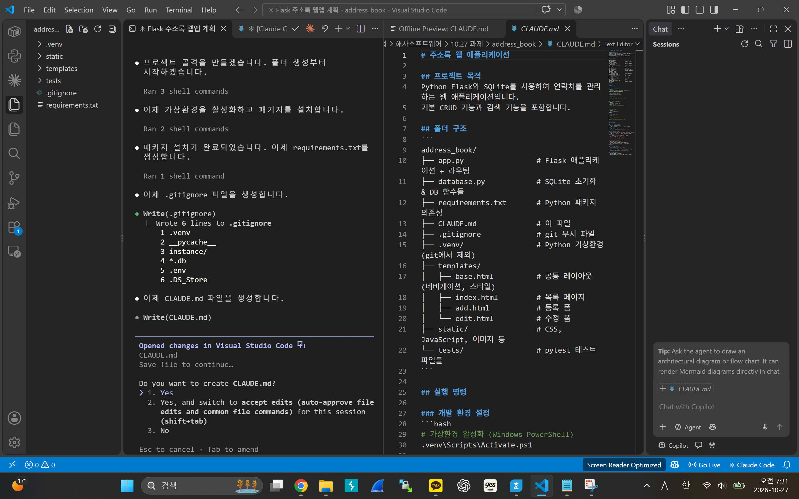
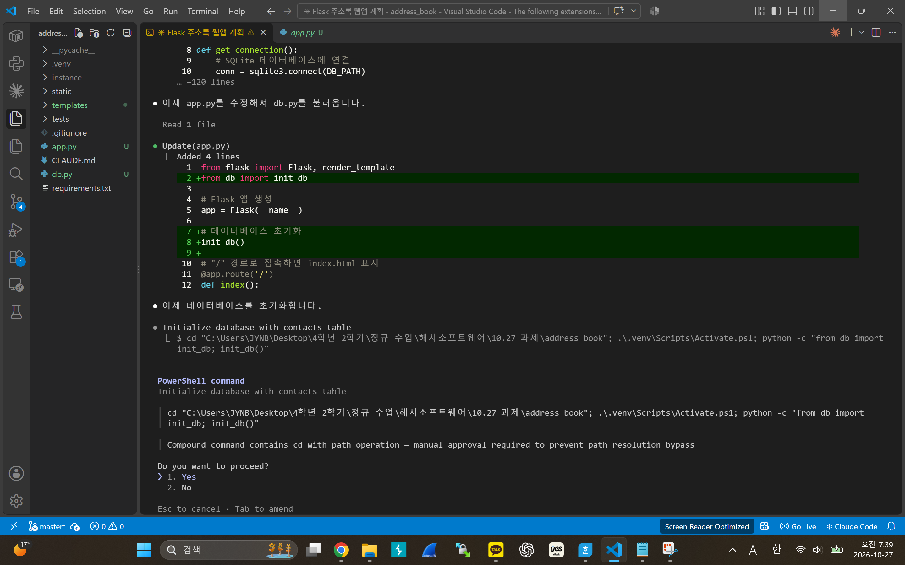
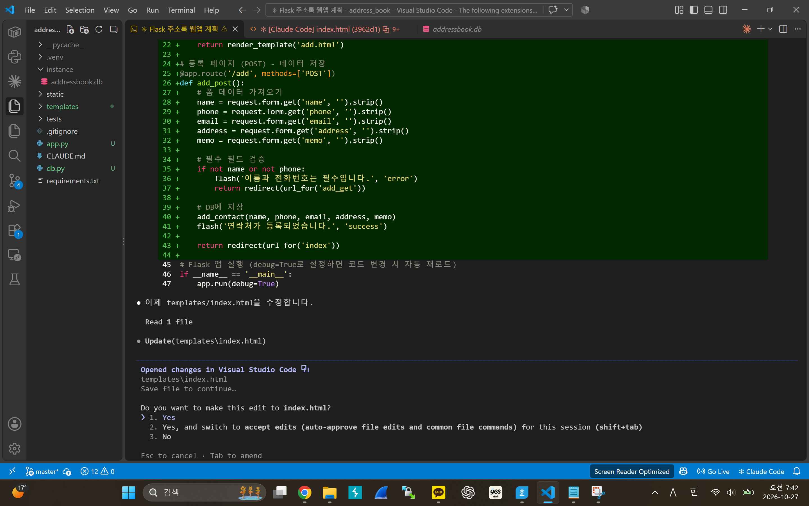
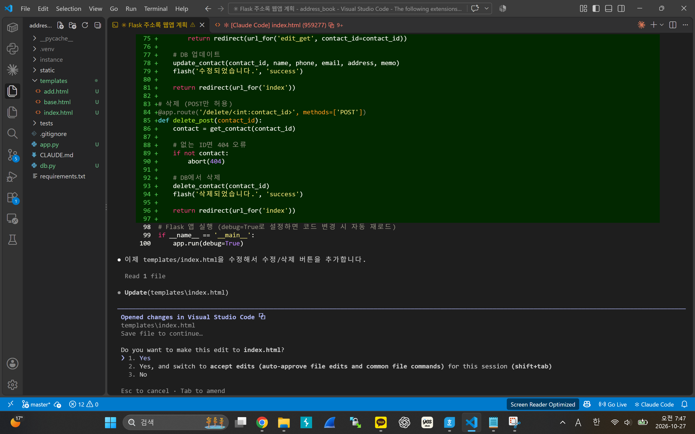
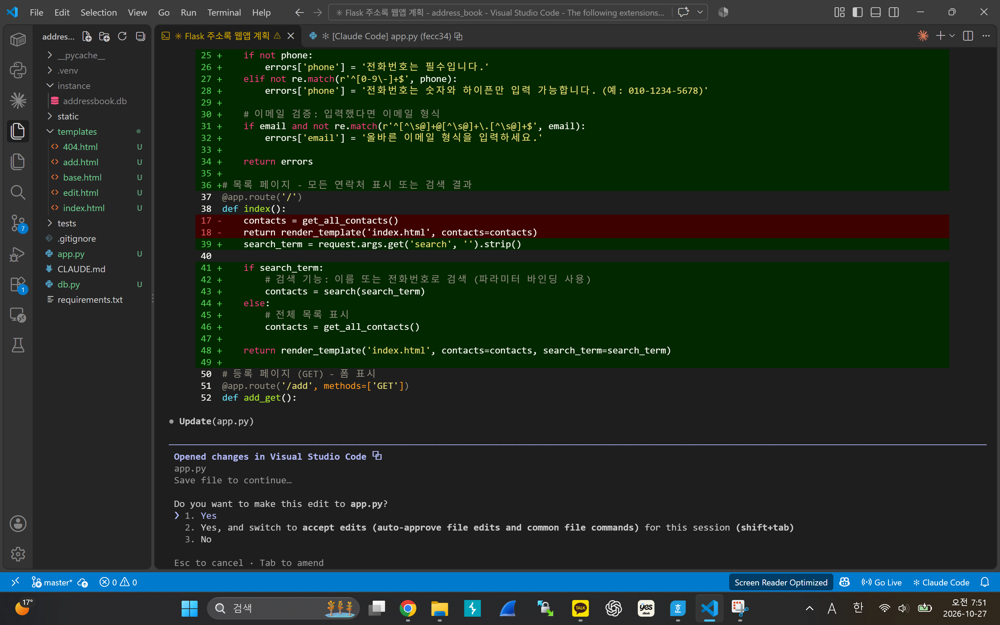
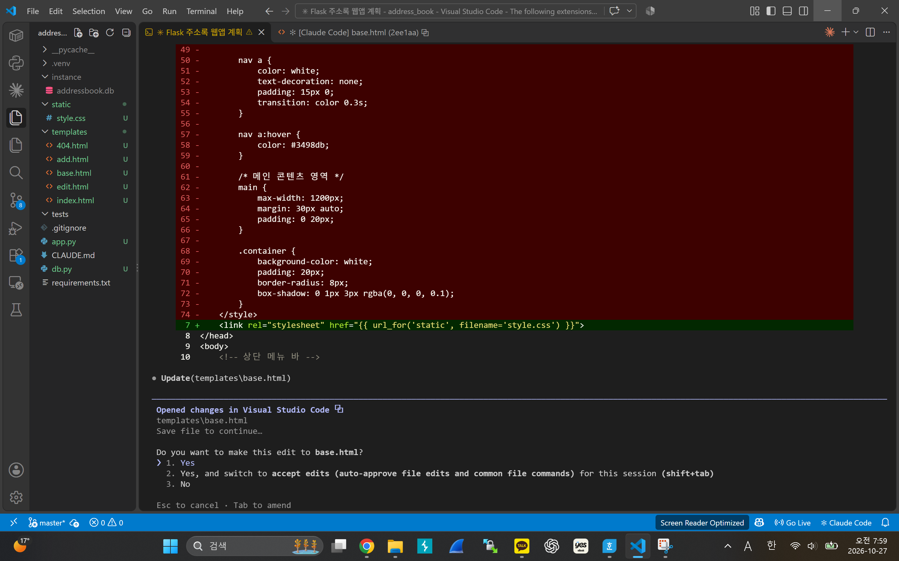
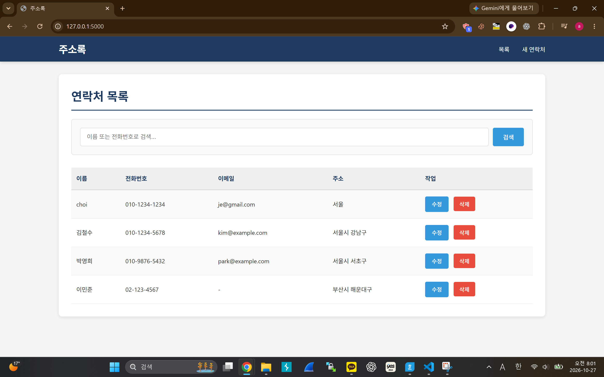
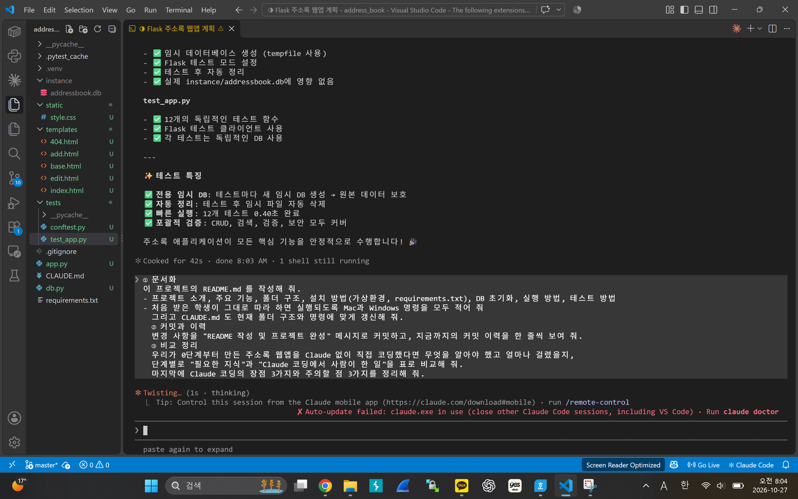

# 해사소프트웨어 9주차 — Claude Code 코딩 반복연습

2026-10-27에 촬영한 실습 화면 중 웹프로젝트 개발 흐름이 드러나는 사진 8장을 선별했습니다.

**다운로드·압축 해제 없이 아래로 스크롤하면 8장을 전부 볼 수 있습니다.**

- 개발 환경: VS Code, Claude Code, Python Flask, SQLite, HTML/CSS, pytest
- 실습 과정: 프로젝트 생성 → 데이터베이스 연결 → CRUD 구현 → 검증·검색 → CSS 개선 → 웹 실행 확인 → 테스트 검토

---

## 01. 프로젝트 구조 및 CLAUDE.md 설정

Claude Code를 이용한 프로젝트 구성과 작업 지침 정리

---

## 02. Flask·SQLite 데이터베이스 초기화

app.py 및 db.py 기반 데이터베이스 연결

---

## 03. 연락처 등록 기능 구현

등록 라우트와 입력 처리 코드 추가

---

## 04. 연락처 수정·삭제 기능 구현

수정·삭제 라우트와 예외 처리 보완

---

## 05. 입력값 검증 및 검색 기능 개선

전화번호·이메일 검증 및 검색 코드 변경

---

## 06. CSS 디자인 수정

기존 스타일을 별도 CSS로 정리하는 수정 장면

---

## 07. 웹 애플리케이션 실행 화면

Chrome 브라우저에서 웹 화면 확인 (VS Code 외 보조 캡처)

---

## 08. 테스트 작성·결과 검토

Claude Code 화면의 테스트 구성 및 결과 요약 (독립 재실행 증명은 아님)

---

> 참고: 07번은 브라우저 실행 화면(보조 자료)입니다. 08번은 VS Code의 Claude Code 테스트 요약이며 테스트를 독립적으로 재실행했다는 뜻은 아닙니다.
